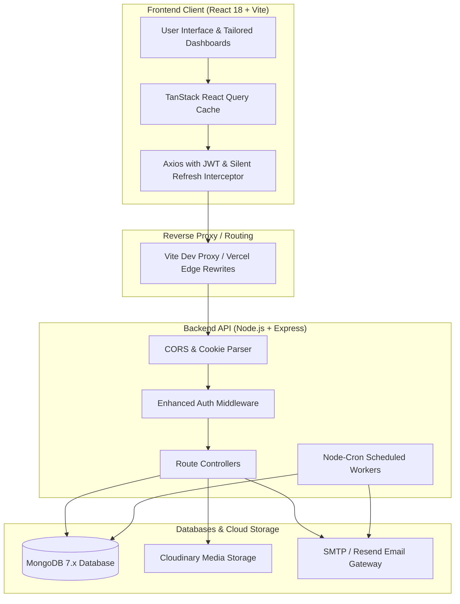
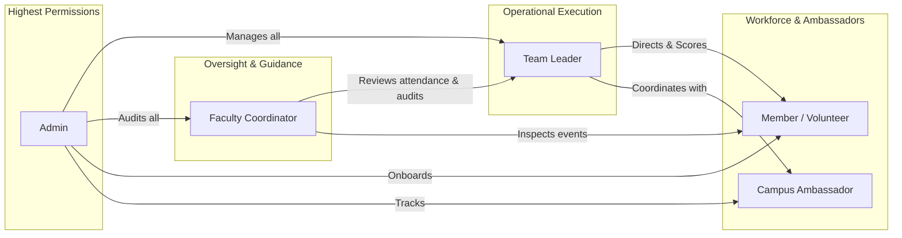
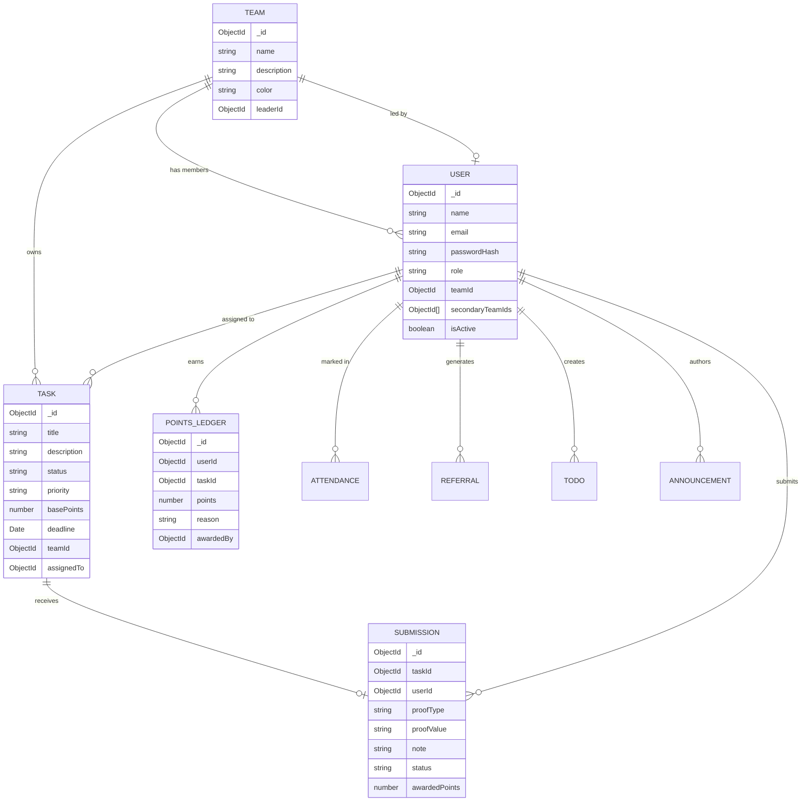

# 🎯 Lakshya 2.0 — Members & Operations Portal

> **The enterprise-grade workforce coordination, task allocation, points gamification, and event operations management platform engineered for Lakshya 2.0.**

[](https://nodejs.org/)
[](https://reactjs.org/)
[](https://vitejs.dev/)
[](https://expressjs.com/)
[](https://mongoosejs.com/)
[](https://tailwindcss.com/)
[](LICENSE)

---

## 📑 Table of Contents

- [📌 Overview](#-overview)
- [✨ Key Features & Capabilities](#-key-features--capabilities)
- [🧩 System Architecture](#-system-architecture)
  - [High-Level Architectural Workflow](#high-level-architectural-workflow)
  - [Task & Proof Verification Flow](#task--proof-verification-flow)
- [🏢 Committees & Workforce Structure](#-committees--workforce-structure)
- [🛡️ Role-Based Access Control (RBAC)](#️-role-based-access-control-rbac)
- [⚙️ Detailed Module Breakdown](#️-detailed-module-breakdown)
  - [1. Authentication & Security Pipeline](#1-authentication--security-pipeline)
  - [2. Task Management & Verification Engine](#2-task-management--verification-engine)
  - [3. Gamified Points System & Leaderboards](#3-gamified-points-system--leaderboards)
  - [4. Attendance Management & Reporting](#4-attendance-management--reporting)
  - [5. Announcements & Email Engine](#5-announcements--email-engine)
  - [6. Campus Ambassador (CA) Referral Program](#6-campus-ambassador-ca-referral-program)
  - [7. Bulk Onboarding via CSV / Excel](#7-bulk-onboarding-via-csv--excel)
  - [8. Centralized Resource Hub](#8-centralized-resource-hub)
- [🗄️ Database Schemas & Data Models](#️-database-schemas--data-models)
- [🛠️ Tech Stack](#️-tech-stack)
- [🚀 Local Development Setup](#-local-development-setup)
  - [Prerequisites](#prerequisites)
  - [Step-by-Step Setup](#step-by-step-setup)
- [🔐 Environment Variables Reference](#-environment-variables-reference)
- [🔑 Seed Accounts & Test Credentials](#-seed-accounts--test-credentials)
- [📡 API Reference Matrix](#-api-reference-matrix)
- [🚢 Deployment Guide](#-deployment-guide)
- [🔧 Troubleshooting & FAQ](#-troubleshooting--faq)
- [📄 License](#-license)

---

## 📌 Overview

**Lakshya 2.0 Members Portal** is the internal operational backbone for organizing **Lakshya 2.0** — an inter-collegiate technical fest and symposium. 

Managing a large-scale event with hundreds of student volunteers, team leads, faculty mentors, and external campus ambassadors typically results in fragmented communication across chat apps, misplaced submission files, and subjective performance evaluations.

This portal solves these challenges by providing:
- A **centralized command center** for organizers and faculty to monitor tasks and deadlines.
- An **audited proof verification system** where completed assignments are vetted before awarding credits.
- An **inter-committee gamification engine** that motivates volunteers through live leaderboards and weekly score digests.
- Seamless **multi-team membership** allowing leads to manage cross-functional duties without separate logins.
- Automated **bulk member onboarding** and communication tools.

---

## ✨ Key Features & Capabilities

- 🛡️ **Role-Based Workspaces:** Dedicated views and permission fences for Admins, Faculty, Team Leaders, Members, and Campus Ambassadors.
- 👥 **Multi-Team Delegation:** Committee assignment with instantaneous team switching for cross-functional members.
- 📋 **Proof Verification Pipeline:** Multi-format submission system (URLs, Cloudinary-hosted documents/media, rich text) with review and revision loops.
- 🏆 **Gamified Points Ledger:** Immutable transaction ledger tracking every credit and deduction with individual and team-level rankings.
- 📅 **Dual-Layer Attendance System:** Daily attendance and event-specific check-ins with analytical exports for faculty coordinators.
- 📢 **Targeted Announcements & Email Broadcasts:** Committee-specific or festival-wide notifications with fallback to SMTP/Resend transactional email delivery.
- 🚀 **Campus Ambassador Growth Funnel:** Unique referral link generation, click analytics, and student registration attribution tracking.
- 📁 **Cloud-Native Resource Center:** Instant access to brand assets, guidelines, rulebooks, circulars, and schedules.
- ⚡ **Personal Productivity Suite:** Integrated private To-do manager and centralized team contact directory.
- 📥 **Batch Member Onboarding:** Import committee members from CSV/Excel with automatic credentials generation and email dispatch.

---

## 🧩 System Architecture

### High-Level Architectural Workflow



---

### Task & Proof Verification Flow

```mermaid
sequenceDiagram
    autonumber
    actor TL as Team Leader / Admin
    actor M as Member / Volunteer
    participant API as Express API Server
    participant DB as MongoDB (Tasks & Points)
    participant CLOUD as Cloudinary Storage

    TL->>API: POST /api/tasks (Title, Description, Base Points, Deadline, Team)
    API->>DB: Save Task (Status: 'assigned')
    DB-->>M: Task visible in "My Tasks"
    
    rect rgb(28, 35, 51)
        Note over M, CLOUD: Member Executes & Submits Proof
        alt File Proof
            M->>API: POST /api/submissions (FormData with Document/Image)
            API->>CLOUD: Stream upload to Cloudinary (PDF/Raw/Image)
            CLOUD-->>API: Secure Media URL
        else Link / Text Proof
            M->>API: POST /api/submissions (URL or Description text)
        end
        API->>DB: Save Submission (Status: 'submitted')
    end

    TL->>API: GET /api/submissions/pending
    API-->>TL: Render Submissions with Attached Proofs

    alt Proof Approved
        TL->>API: PATCH /api/submissions/verify (Status: 'approved', Points: +N)
        API->>DB: Create PointsLedger Entry (+N points)
        API->>DB: Update Member Total Score & Task status ('completed')
        DB-->>M: Points credited & Leaderboard updated
    else Revision Requested / Rejected
        TL->>API: PATCH /api/submissions/verify (Status: 'rejected', Feedback)
        API->>DB: Update Task status ('revision_requested')
        DB-->>M: Re-submission required with reviewer notes
    end
```



---

## 🏢 Committees & Workforce Structure

The portal is structured around the 7 primary functional pillars of Lakshya 2.0:

| Committee | Key Responsibilities | Primary Tasks |
|---|---|---|
| 💻 **Tech** | Web portals, judging software, AV hardware, network infrastructure | Server management, bug fixes, digital scoring |
| 📢 **PR & Publicity** | Media coverage, campus outreach, external communications | Press releases, college visits, viral campaigns |
| 📈 **Marketing** | Social media marketing, event campaigns, registrations drive | Ad creatives, influencer outreach, registrations |
| 🤝 **Sponsorship** | Corporate partnerships, funding, deliverables fulfillment | Pitch decks, sponsor liaison, stall allocation |
| 🎨 **Graphics & Visuals**| Brand identity, posters, stage backdrops, UI creatives | Social banners, badges, brochures, certificate designs |
| 🚚 **Production & Logistics** | Stage fabrication, seating, catering, physical logistics | Vendor coordination, crowd control, equipment handling |
| 🎪 **Content & Decoration** | Event schedules, anchor scripts, aesthetic decorations | Rulebook curation, stage lighting, venue decor |

---

## 🛡️ Role-Based Access Control (RBAC)

The application enforces strict separation of concerns across 5 roles:



| Role | Accessible Routes | Capabilities |
|---|---|---|
| **Admin** | `/admin/*` | Full CRUD on users, teams, events, tasks, announcements, resources, bulk member imports, attendance, and manual bulk email broadcast. |
| **Faculty** | `/faculty/*` | Read-only analytics, institutional attendance audit reports, event timelines, and announcement inspection. |
| **Team Leader** | `/tl/*` | Create tasks, review/grade member submissions, mark committee attendance, broadcast team notices, import members to own team, and switch between managed teams. |
| **Member** | `/vol/*` | View assigned tasks, submit multi-format proofs, monitor personal point balance, log personal todos, review team resources, and view live leaderboards. |
| **Campus Ambassador**| `/vol/*` + `/vol/referrals` | All Member capabilities plus personal referral code generation, click stats, conversion tracking, and ambassador rank. |

---

## ⚙️ Detailed Module Breakdown

### 1. Authentication & Security Pipeline
- **Dual-Token System:** 
  - **Access Token:** Short-lived (15 minutes) signed with `JWT_SECRET`, carried in the `Authorization: Bearer <token>` header for stateless API verification.
  - **Refresh Token:** Long-lived (7 days) signed with `JWT_REFRESH_SECRET`, stored inside an `httpOnly`, `SameSite=Lax` cookie with server-side bcrypt hash verification.
- **Silent Refresh Interceptor:** The frontend Axios client automatically intercepts `401 TOKEN_EXPIRED` errors, requests a fresh token pair via `/api/auth/refresh`, and seamlessly replays the failed request queue without user interruption.
- **Brute-Force Safeguard:** Login endpoints employ rate-limiting (`express-rate-limit`) and password validation using bcrypt (cost factor 12).

---

### 2. Task Management & Verification Engine
- **Task Schema Attributes:** Title, detailed requirements markdown, base point weightage, hard deadline, priority (`low`, `medium`, `high`, `urgent`), committee ownership, and assignee ID.
- **Three-Tier Proof Submissions:**
  1. **Direct Link:** URLs to live deliverables, Git pull requests, Figma files, or cloud folders.
  2. **File & Media Proof:** Uploaded directly via Multer and streamed to Cloudinary into the dedicated `techfest_uploads` folder. The system dynamically tags files as `image` or `raw` (for `.pdf`, `.docx`, `.csv`) so browsers render PDFs and preview documents natively.
  3. **Rich Text / Writeup:** For content writers, PR coordinators, and logisticians describing physical execution.
- **Iterative Revision:** If a submission falls short, leads can reject the proof with constructive feedback. The task reverts to `revision_requested`, allowing the member to upload an updated proof without cluttering the review queue.

---

### 3. Gamified Points System & Leaderboards
- **Double-Entry Ledger Pattern:** Points are never mutated directly on the user model. Instead, every award or deduction creates an immutable record in `PointsLedger` referencing `userId`, `taskId`, `points`, `awardedBy`, and `reason`.
- **High-Performance Aggregations:** Leaderboards are computed on-demand using MongoDB aggregation pipelines:
  - Unwinding user profiles and team metadata.
  - Grouping and summing net points.
  - Sorting and projecting rankings with rank badges (🥇 Gold, 🥈 Silver, 🥉 Bronze).
- **Automated Monday Cron Digest:** A background worker running via `node-cron` every Monday morning aggregates weekly performances and distributes email summaries to teams.

---

### 4. Attendance Management & Reporting
- Supports multi-session logging (Morning briefing, Event shifts, Debriefs).
- **Attendance States:** `Present`, `Absent`, `Late`, `Excused`.
- Allows Team Leaders to mark attendance for their roster with a single click.
- Provides Faculty mentors with automated attendance summaries and percentages for college credit accreditation.

---

### 5. Announcements & Email Engine
- **Priority Signaling:** Critical updates can be flagged as `Urgent` to trigger visual banners in member dashboards.
- **Audience Targeting:** Announcements can be scoped to individual committees (e.g., Tech team only) or published globally.
- **Hybrid Email Dispatcher:** 
  - Seamlessly switches between **Nodemailer** (custom institutional SMTP) and **Resend** depending on configuration.
  - High-deliverability HTML templates for account invitations, password resets, verification links, and broadcast alerts.

---

### 6. Campus Ambassador (CA) Referral Program
- Each Campus Ambassador receives an automated unique slug and referral link:
  $$\text{URL} = \text{https://lakshya-fest.com/register?ref=} + \langle\text{Ambassador Code}\rangle$$
- System records click traffic, verified student registrations, and converts them into gamified CA points.
- Real-time conversion leaderboard specifically for tracking college-wise outreach.

---

### 7. Bulk Onboarding via CSV / Excel
- Admins and Team Leaders can batch-import hundreds of committee members in seconds using `.csv` or `.xlsx` files.
- **Supported Fields:** `Name`, `Email`, `Role`, `Team`, `Phone`, `College`.
- Auto-maps team names to internal ObjectIDs.
- Automatically generates secure random passwords (or sets an optional configurable default).
- Optional toggle to automatically dispatch welcome emails with initial login credentials.

---

### 8. Centralized Resource Hub
- Organizers upload and organize critical digital collateral:
  - Official rulebooks and event judging criteria.
  - Vector logos, posters, slide decks, and brand guideline packs.
  - Vendor spreadsheets, venue blueprints, and contact cheat sheets.
- Secured download URLs ensuring sensitive festival assets remain restricted to authenticated personnel.

---

## 🗄️ Database Schemas & Data Models



---

## 🛠️ Tech Stack

### Frontend Ecosystem
- **Core Library:** [React 18](https://react.dev/) (Functional components & hooks)
- **Build System:** [Vite 5](https://vitejs.dev/) (Ultra-fast HMR and ESM bundling)
- **Styling:** [Tailwind CSS 3](https://tailwindcss.com/) with custom dark palette & animations
- **Server-State Management:** [TanStack React Query v5](https://tanstack.com/query/latest) (Caching, optimistic updates, garbage collection)
- **Routing:** [React Router v6](https://reactrouter.com/) (Protected layout routes & redirection)
- **Data Visualization:** [Recharts](https://recharts.org/) (Analytics graphs & performance charts)
- **Notifications:** [React Hot Toast](https://react-hot-toast.com/) (Non-intrusive toast alerts)
- **Form Handling:** [React Hook Form](https://react-hook-form.com/)

### Backend Ecosystem
- **Runtime Environment:** [Node.js](https://nodejs.org/) (v18+)
- **Server Framework:** [Express.js 4](https://expressjs.com/)
- **Database:** [MongoDB](https://www.mongodb.com/) (NoSQL Document Store)
- **Object Data Modeling:** [Mongoose 8](https://mongoosejs.com/)
- **Security & Cryptography:** `jsonwebtoken`, `bcryptjs`, `cookie-parser`, `cors`
- **File Ingestion & Cloud Storage:** `multer`, `cloudinary`, `multer-storage-cloudinary`
- **Email Infrastructure:** `nodemailer`, `@resend/node`
- **Scheduled Workers:** `node-cron`
- **Logging & Diagnostics:** `winston`, `morgan`
- **Data Import Parsing:** `xlsx`

---

## 🚀 Local Development Setup

### Prerequisites
Make sure your workstation has the following tools installed:
- [Node.js](https://nodejs.org/) `>= 18.0.0`
- [npm](https://www.npmjs.com/) `>= 9.0.0`
- [MongoDB Community Server](https://www.mongodb.com/try/download/community) running locally on port `27017` (or an active MongoDB Atlas cluster URI).

---

### Step-by-Step Setup

#### 1. Clone the Repository
```bash
git clone https://github.com/vagelavibhu2007/Lakshya.git
cd Lakshya
```

#### 2. Configure Environment Files

##### Server Environment (`server/.env`)
Create `server/.env` with the following configuration:
```env
PORT=5000
NODE_ENV=development
MONGO_URI=mongodb://127.0.0.1:27017/techfest

# Security Secrets
JWT_SECRET=techfest_jwt_secret_dev_key_2026_super_secure
JWT_REFRESH_SECRET=techfest_jwt_refresh_secret_dev_key_2026_super_secure
JWT_ACCESS_EXPIRES=15m
JWT_REFRESH_EXPIRES=7d

# Cross-Origin Policies
CLIENT_ORIGIN=http://localhost:5173
CLIENT_URL=http://localhost:5173

# Email Gateway (Optional for local dev)
EMAIL_SERVICE=nodemailer
SMTP_HOST=smtp.gmail.com
SMTP_PORT=587
SMTP_USER=
SMTP_PASS=

# Media Storage (Optional for local dev; dummy values work for text/link proofs)
CLOUDINARY_CLOUD_NAME=dummy_cloud
CLOUDINARY_API_KEY=dummy_key
CLOUDINARY_API_SECRET=dummy_secret
```

##### Client Environment (`client/.env`)
Create `client/.env` with:
```env
VITE_API_URL=http://localhost:5000
```

#### 3. Install Dependencies
```bash
# Install backend dependencies
cd server
npm install

# Install frontend dependencies
cd ../client
npm install
```

#### 4. Seed the Database
Populate your local MongoDB instance with the 7 default committees, mock tasks, announcements, and pre-configured role users:
```bash
cd ../server
npm run seed
```

#### 5. Launch Local Services

You can start both servers concurrently in two separate terminal windows:

**Terminal 1 (Backend API):**
```bash
cd server
npm run dev
# Express server listening at http://localhost:5000
```

**Terminal 2 (Frontend Client):**
```bash
cd client
npm run dev
# Vite dev server running at http://localhost:5173
```

Navigate to **[http://localhost:5173](http://localhost:5173)** in your browser to access the portal.

---

## 🔐 Environment Variables Reference

### Backend (`server/.env`)

| Variable | Required | Default | Description |
|---|---|---|---|
| `PORT` | Optional | `5000` | Port for the Express server to listen on. |
| `NODE_ENV` | Yes | `development` | Environment mode (`development` or `production`). |
| `MONGO_URI` | Yes | — | MongoDB connection string (local or Atlas URI). |
| `JWT_SECRET` | Yes | — | Private key used to sign HMAC-SHA256 access tokens. |
| `JWT_REFRESH_SECRET` | Yes | — | Private key used to sign refresh tokens. |
| `JWT_ACCESS_EXPIRES` | Optional | `15m` | Lifetime of access tokens. |
| `JWT_REFRESH_EXPIRES`| Optional | `7d` | Lifetime of refresh tokens. |
| `CLIENT_ORIGIN` | Yes | `http://localhost:5173` | Allowed origin for CORS headers. |
| `CLIENT_URL` | Yes | `http://localhost:5173` | Base client URL embedded in email verification links. |
| `EMAIL_SERVICE` | Optional | `nodemailer` | Active email transport engine (`nodemailer` or `resend`). |
| `SMTP_HOST` | Conditional | — | Host of your SMTP relay server. |
| `SMTP_PORT` | Conditional | `587` | Port for SMTP relay server. |
| `SMTP_USER` | Conditional | — | Username / email address for SMTP authentication. |
| `SMTP_PASS` | Conditional | — | App password / token for SMTP server. |
| `RESEND_API_KEY` | Conditional | — | API key for Resend email service. |
| `CLOUDINARY_CLOUD_NAME` | Conditional | — | Cloudinary cloud namespace. |
| `CLOUDINARY_API_KEY` | Conditional | — | API key for authenticated Cloudinary uploads. |
| `CLOUDINARY_API_SECRET` | Conditional | — | API secret for authenticated Cloudinary uploads. |

### Frontend (`client/.env`)

| Variable | Required | Default | Description |
|---|---|---|---|
| `VITE_API_URL` | Optional | `http://localhost:5000` | Backend API base origin. Leave empty to use relative `/api` proxy. |

---

## 🔑 Seed Accounts & Test Credentials

The database seeder (`server/seed.js`) provides ready-to-use testing credentials:

| Role | Email | Password | Primary Committee |
|---|---|---|---|
| **System Admin** | `admin@techfest.com` | `Admin@123` | *All Committees* |
| **Faculty Coordinator** | `faculty@techfest.com` | `Faculty@123` | *All Committees* |
| **Team Leader (Tech)** | `tl.tech@techfest.com` | `Leader@123` | Tech |
| **Team Leader (PR)** | `tl.pr@techfest.com` | `Leader@123` | PR & Publicity |
| **Team Leader (Marketing)**| `tl.mkt@techfest.com` | `Leader@123` | Marketing |
| **Member (Volunteer 1)** | `vol1@techfest.com` | `Vol@12345` | Tech |
| **Member (Volunteer 2)** | `vol2@techfest.com` | `Vol@12345` | Tech |
| **Member (Volunteer 3)** | `vol3@techfest.com` | `Vol@12345` | PR & Publicity |
| **Member (Volunteer 4)** | `vol4@techfest.com` | `Vol@12345` | Marketing |
| **Campus Ambassador 1** | `ca1@techfest.com` | `CA@12345` | PR & Publicity |
| **Campus Ambassador 2** | `ca2@techfest.com` | `CA@12345` | Marketing |

---

## 📡 API Reference Matrix

### Authentication Endpoints (`/api/auth`)
- `POST /api/auth/login` — Authenticate credentials, set refresh cookie, and return access token.
- `POST /api/auth/refresh` — Issue a new access token using the HTTP-only refresh cookie.
- `POST /api/auth/logout` — Invalidate user refresh token and clear session cookies.
- `GET /api/auth/me` — Return profile data of the currently authenticated user.
- `POST /api/auth/switch-team` — Switch active team context for multi-team members.

### Task & Submission Endpoints (`/api/tasks`, `/api/submissions`)
- `GET /api/tasks` — List tasks filtered by team, assignee, or priority.
- `POST /api/tasks` — Create a new task assignment *(Admin / Team Leader)*.
- `GET /api/tasks/:id` — Retrieve task details and submission history.
- `PATCH /api/tasks/:id` — Edit task parameters or deadline *(Admin / Team Leader)*.
- `POST /api/submissions/:taskId` — Submit link, text, or file proof for task review.
- `PATCH /api/submissions/verify` — Approve or reject a proof submission with points and notes.

### Gamification Endpoints (`/api/points`)
- `GET /api/points/leaderboard` — Retrieve global individual and team rankings.
- `GET /api/points/my-points` — Fetch user points balance and complete transaction ledger.
- `POST /api/points/award` — Manually grant or deduct points with audit reason *(Admin)*.

### Attendance Endpoints (`/api/attendance`)
- `POST /api/attendance` — Mark attendance records for a committee roster.
- `GET /api/attendance/summary` — Retrieve aggregated team attendance metrics.
- `GET /api/attendance/report` — Export structured attendance data for faculty evaluation.

### Organization & Operations (`/api/teams`, `/api/announcements`, `/api/resources`, `/api/todos`)
- `GET /api/teams` — List all 7 committees with leader details and member rosters.
- `GET /api/announcements` — Retrieve broadcasts targeted to user committee.
- `POST /api/announcements` — Publish a new bulletin with optional email dispatch.
- `GET /api/resources` — Access downloadable event guides, rulebooks, and creative assets.
- `GET /api/todos` / `POST /api/todos` — Personal private task checklist.
- `POST /api/admin/users/import` — Process batch member onboarding via CSV or XLSX.

---

## 🚢 Deployment Guide

### Frontend Deployment (e.g., Vercel)
The client includes a ready-to-use [`vercel.json`](file:///f:/code/Mini%20Project/New%20folder/Lakshya/client/vercel.json) configured for single-page application routing and API reverse-proxying:
```json
{
  "rewrites": [
    { "source": "/api/(.*)", "destination": "https://your-backend.onrender.com/api/$1" },
    { "source": "/uploads/(.*)", "destination": "https://your-backend.onrender.com/uploads/$1" },
    { "source": "/(.*)", "destination": "/index.html" }
  ]
}
```

### Backend Deployment (e.g., Render, Railway, VPS)
1. Set `NODE_ENV=production`.
2. Supply a cloud MongoDB connection string (e.g. MongoDB Atlas).
3. Set `CLIENT_ORIGIN=https://your-frontend.vercel.app`.
4. Configure production Cloudinary and SMTP / Resend API credentials.
5. Start command: `node index.js`.

---

## 🔧 Troubleshooting & FAQ

#### Q: MongoDB connection fails with DNS errors on Atlas SRV (`mongodb+srv://...`).
> **Fix:** Node.js v18+ can sometimes fail DNS resolution with certain local ISPs. The backend includes `dns.setServers(["1.1.1.1"])` to automatically resolve Atlas SRV records. If running against local MongoDB, ensure your URI uses raw IP literal `mongodb://127.0.0.1:27017/techfest`.

#### Q: File upload fails with `File type not allowed`.
> **Fix:** The multer middleware permits `.pdf`, `.csv`, `.docx`, `.doc`, `.jpg`, `.jpeg`, `.png`, `.gif`, `.webp`, and `.txt`. If you need to support additional archives or file types, update the allowed list in [`server/src/config/multer.js`](file:///f:/code/Mini%20Project/New%20folder/Lakshya/server/src/config/multer.js).

#### Q: How do I completely wipe and re-seed the test data?
> **Fix:** Run `npm run seed` inside the [`server/`](file:///f:/code/Mini%20Project/New%20folder/Lakshya/server) directory. This will drop users, teams, tasks, announcements, events, and resources, rebuilding fresh baseline seed records.

---

## 📄 License

This software and its documentation are developed and maintained exclusively for the internal operations of the **Lakshya 2.0** festival. Unauthorized distribution, modification, or public hosting is strictly prohibited. All rights reserved.